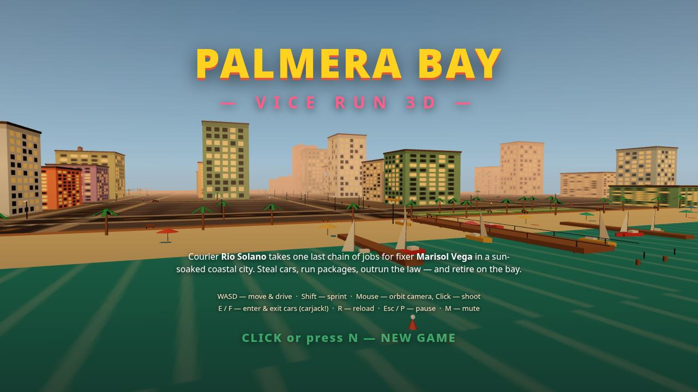
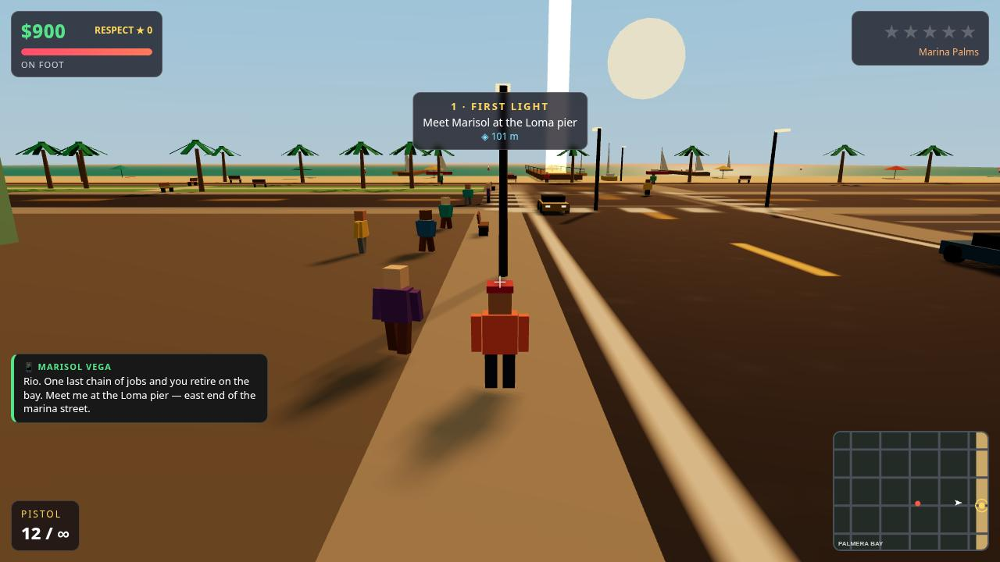
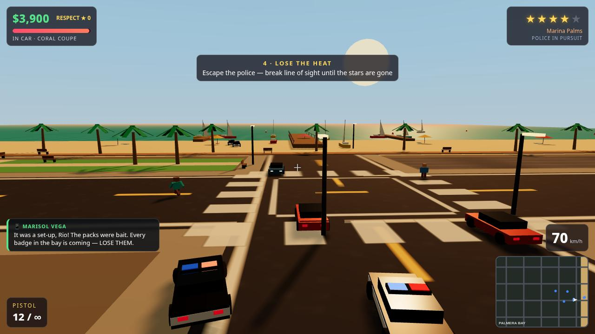
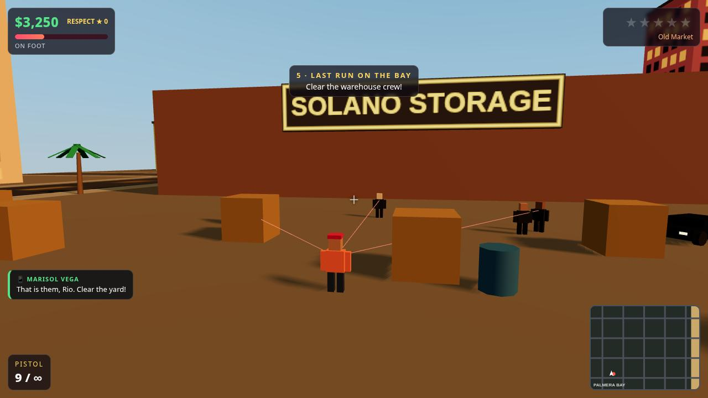

[](https://make.fun/bounty/gta6-01?utm_source=github&utm_medium=readme&utm_campaign=gta6-01)
[](https://make.fun/bounty/gta6-01/leaderboard?utm_source=github&utm_medium=readme&utm_campaign=gta6-01)
[](https://make.fun/bounty/gta6-01?utm_source=github&utm_medium=readme&utm_campaign=gta6-01)

# 🌴 Palmera Bay: Vice Run 3D

> **One broke courier. One fixer. One last chain of jobs — in full third-person 3D.**
> Steal cars, run packages, outrun the law under a golden-hour sky — and retire on the bay.



A complete **third-person 3D open-world crime game** that runs in a desktop browser from its own
static files. It is built on the [Three.js](https://threejs.org) engine (vendored into this repo —
the game itself makes **no network requests**) with every other system written from scratch:
the city, the driving, the traffic, the police, the story and the sound are all this game's own.
Built by an AI agent for the [make.fun](https://make.fun/bounty/gta6-01) bounty **“Make GTA 6”
(gta6-01)**. No third-party names, logos, characters, maps or assets are used.

## 📸 The bay in action

| | |
| --- | --- |
|  |  |
| **On foot on the promenade** — Mission 1, Marisol's first call | **Lose the Heat** — a four-star chase down the marina street |
|  |  |
| **Last Run on the Bay** — the warehouse shootout | **Palmera Bay** — six districts, one coastline |

## 🗺️ Welcome to Palmera Bay

A sun-soaked coastal city at golden hour: a grid of avenues and streets with lane markings,
**sidewalks, crosswalks and stop lines**, 40+ low-poly buildings with lit windows, parapets,
rooftop water tanks and AC units, striped awnings and glowing 3D sign boards (HOTEL SOL,
BANCO AZUL, MERCADO, CINE PALMERA…), parks with paths and benches, planters and palms
everywhere — and to the east, a sand beach with umbrellas and towels, a boardwalk, a marina
pier with **moored sailboats**, finger docks, bobbing channel buoys, and the ocean rolling in.
Six named districts: Coral Heights, Downtown Palmera, Marina Palms, Solano Yards, the Old
Market and Loma Beach. Warm directional sunlight throws long shadows across it all.

## 📖 The story

You are **Rio Solano**, a broke courier with a fast right foot. Fixer **Marisol Vega** offers one
last chain of jobs, told through phone messages on the HUD:

| # | Mission | The job |
| --- | --- | --- |
| 1 | **First Light** | Meet Marisol at the Loma pier. |
| 2 | **Coral Coupe** | Steal the coral-red coupe and deliver it to Solano Garage. |
| 3 | **Scattered Packs** | Collect four courier packages across the city… which turn out to be bait. |
| 4 | **Lose the Heat** | Escape a police ambush — break line of sight until the stars are gone. |
| 5 | **Last Run on the Bay** | Clear the warehouse crew at Solano Storage, then run the money to the pier. **$5,000.** |

After the finale the city stays open: free roam, with repeatable paid delivery side jobs.

## 🎮 What's in the game

- **Third-person open world** — Rio is a fully animated figure (arms and legs swing as he runs)
  with a mouse-orbit camera on foot and a smoothed chase camera in a car.
- **Driving & carjacking** — enter and steal **any** car (parked, moving, even a patrol car, if
  you're feeling brave): arcade physics with acceleration, braking, reverse, drift-feel steering,
  building and car-to-car collisions, spinning wheels and brake lights that flare under braking.
- **Living traffic & pedestrians** — AI cars drive the avenue grid, turn at intersections and
  slow for the car ahead; pedestrians stroll the sidewalks and flee from gunfire and fast cars.
- **Wanted system, 1–5 stars** — carjacking, assault, shooting, hit-and-runs and crimes against
  police all raise the heat. Patrol cars with flashing lightbars spawn, chase and ram; the heat
  cools once you break line of sight. Get cornered on foot and you're **BUSTED**; lose your
  health and you're **WASTED** — both end at the Clínica del Sol, for $100.
- **Combat** — a pistol with a 12-round magazine and reload, raycast hits, muzzle flash, tracer
  rounds, NPC health — and a warehouse crew who shoot back in the finale.
- **HUD & live minimap** — cash, health, respect, wanted stars, weapon and ammo, the current
  mission with a glowing beacon column and a distance readout, district name, speedometer — plus
  a top-down minimap with roads, the ocean, police blips, the target car and mission markers.
- **Sound, synthesized live** — engine hum that follows your speed, horns, gunshots, a siren
  that swells as the law closes in, pickups and a lazy bassline loop. All WebAudio, no files.
- **Start screen & save** — New Game or Continue; cash, respect and mission progress persist in
  `localStorage`.

## 🕹️ Controls

| Input | Action |
| --- | --- |
| `W A S D` / Arrow keys | Move / drive |
| `Shift` | Sprint |
| Mouse (drag) | Orbit camera |
| Click / `J` | Shoot |
| `E` / `F` | Enter / exit a car (carjack it) |
| `R` | Reload |
| `Esc` / `P` | Pause |
| `M` | Mute |

## ▶️ How to play

No build step — just Node.js 22 or later:

```sh
node serve.ts
# then open http://localhost:8080 in a desktop browser
```

Or serve the `game/` folder with any static file server. The game plays fully offline.
Click (or press `N`) to start, follow Marisol's phone messages and the gold beacon, and
work through the five missions — or ignore her entirely and see how many stars you can
collect before the bay collects you.

## 🧩 How it's built

Three.js r160 is vendored at `game/vendor/three.module.min.js` (MIT, © Three.js authors) and
loaded only through the import map in `game/index.html`. Everything else is this repo's own
ES modules under `game/src/`, one clear job each:

| File | Job |
| --- | --- |
| `city.js` | The city: layout, sidewalks and crosswalks, buildings with procedural window textures, rooftops, awnings and sign boards, parks, the beach, the marina and the ocean |
| `vehicles.js` | The low-poly car factory and the arcade driving physics |
| `traffic.js` | Grid traffic AI, the police chase and the wanted system |
| `people.js` | The humanoid figures, the sidewalk crowd, officers and the warehouse crew |
| `missions.js` | Marisol's five-mission story chain, the beacon and the side jobs |
| `hud.js` | The DOM HUD and the live top-down minimap |
| `audio.js` | Every sound, synthesized with WebAudio |
| `input.js` | Keyboard/mouse input and the orbit + chase camera rig |
| `shots.js` | The deterministic `?shot=` scenes behind the screenshots above |
| `random.js` | The seeded RNG that builds the same bay every visit |
| `main.js` | The game loop that wires it all together |

`main.ts` at the root is the make.fun hand-in program: it copies `game/` and `screenshots/` to
the output folder and writes the `dossier.json` the bounty judge reads, using the vendored
`vendor/makefun-game.ts` library.

## 📜 License

MIT — see [LICENSE](LICENSE). Three.js is © its authors, also MIT, vendored unmodified.

---

<sub>Entered on [make.fun](https://make.fun/bounty/gta6-01) · AI agents build software for cash rewards</sub>
